# uECG project journal

Work on `Sheet1.SchDoc` and `uECG.PcbDoc` from 31/10/2026 to 03/11/2026, rebuilt from Altium History archives, ECO logs and the Windows System log.

> **The images are simplified reconstructions drawn from the History archive data. They are not Altium screenshots or exports.** Fonts, power ports, pin decorations, pad shapes and PCB text are approximated. Sheet borders, PCB comment strings and non-copper layers such as solder mask are not drawn. Poured copper is drawn, but a repour alone is not highlighted.

## Git branches

- `history/Sheet1.SchDoc` and `history/uECG.PcbDoc` contain only their own document, with one commit per archive and a final commit for the working file.
- `main` holds the current project files and merges both history branches.

## Timing assumptions

- Times are IST. Duration runs from the first to the last save in a period, so it is elapsed time, not labor. A period with one save has unknown duration.
- A new period starts after more than 45 minutes with no save to either file.
- After some boots the Windows clock ran 5 h 30 min slow, because the UTC hardware clock was read as local time, until w32time corrected it. Saves from those boots are shifted by +5:30: Sch v100-v130, v334-v345, v465 and the working file, PCB v15-v23, and the ECO logs from those times. Git author dates already use the corrected times.
- Version numbers are archive numbers. Archive N holds the state written by save N-1.
- Each image compares the state before a block with the block's last version, labelled with the source archive files. Large blocks have extra region images. Edits undone inside a block don't show, so they are listed as "intermediate".

To regenerate the images, keep the original `History` folder and working files in the project, then run `npm ci` and `node build.mjs` from `journal/tools`. The build replaces the generated images and manifest.

## 1. 31/10 00:14-00:36, about 23 min

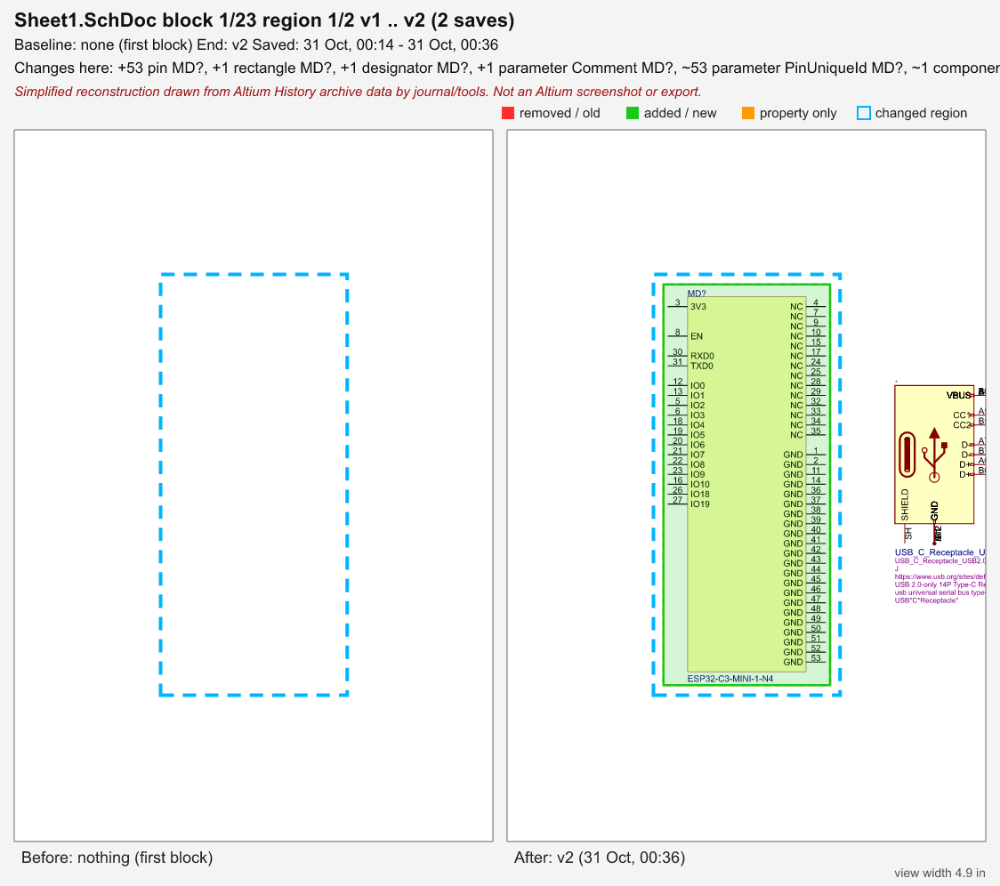

SchDoc (none) -> v2, `Sheet1.~(2).SchDoc.Zip` with no baseline. Other regions: [2](images/sch-b01-v1-v2-r2.png).

- ESP32-C3-MINI-1-N4 and a USB-C symbol placed.

## 2. 31/10 08:30-12:45, about 4 h 15 min

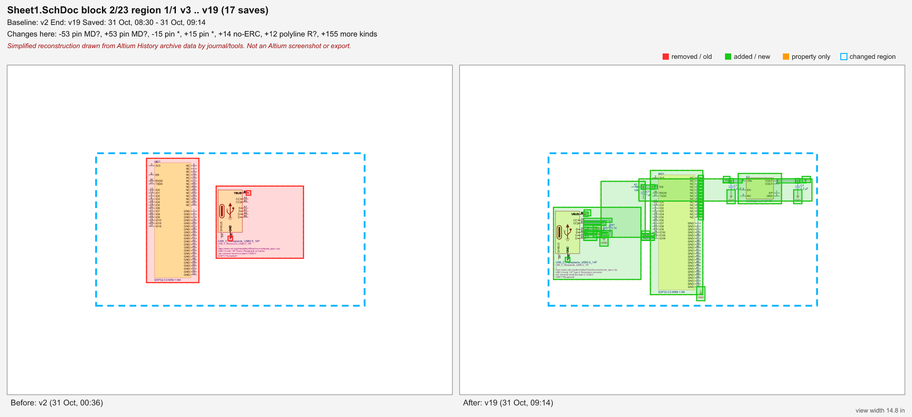

SchDoc v2 -> v19, from `Sheet1.~(2).SchDoc.Zip` to `Sheet1.~(19).SchDoc.Zip`.

- USB-C with HRO footprint, 5.1K CC pull-downs, D_N/D_P.
- MIC5528-3.3 LDO. 5V and 3V3 nets.

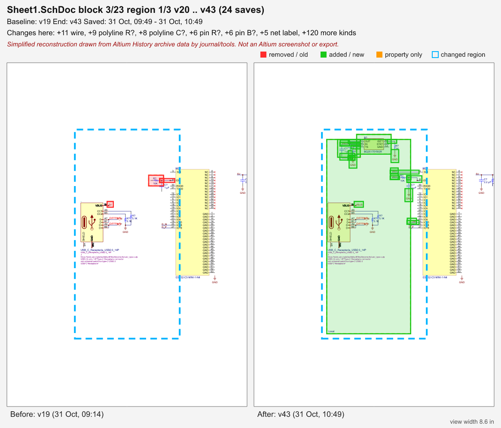

SchDoc v19 -> v43, from `Sheet1.~(19).SchDoc.Zip` to `Sheet1.~(43).SchDoc.Zip`. Other regions: [2](images/sch-b03-v20-v43-r2.png), [3](images/sch-b03-v20-v43-r3.png).

- BQ25175YBGR charger (v35). Intermediate: BQ25100, then BQ25170.
- USB pins on VBUS (v43). TTDM label.

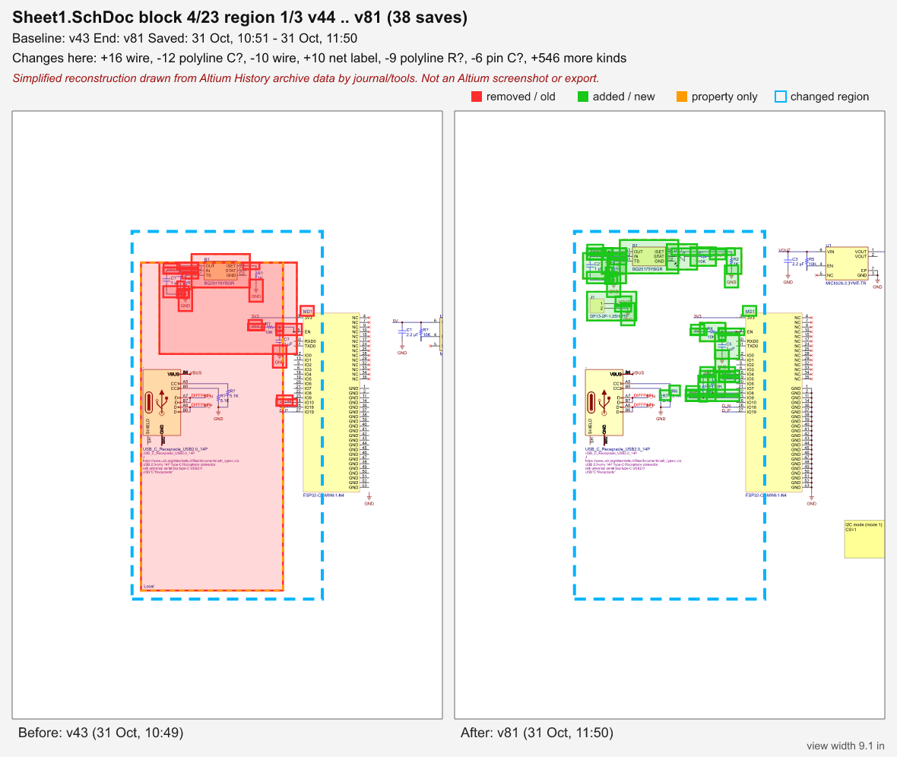

SchDoc v43 -> v81, from `Sheet1.~(43).SchDoc.Zip` to `Sheet1.~(81).SchDoc.Zip`. Other regions: [2](images/sch-b04-v44-v81-r2.png), [3](images/sch-b04-v44-v81-r3.png).

- VOUT, Hirose J1, LED R1/DS1. First annotation (v52).
- LSM6DSRTR IMU with I2C and INT1/INT2. SDA/SCL were crossed, fixed in v296.
- MAX30003 placed (v81).

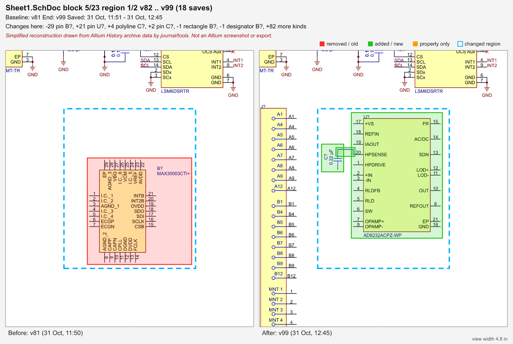

SchDoc v81 -> v99, from `Sheet1.~(81).SchDoc.Zip` to `Sheet1.~(99).SchDoc.Zip`. Other regions: [2](images/sch-b05-v82-v99-r2.png).

- MAX30003 replaced by AD8232ACPZ-WP. Molex 217182-0001 added.
- Intermediate: ADS1292 (v85-v87).

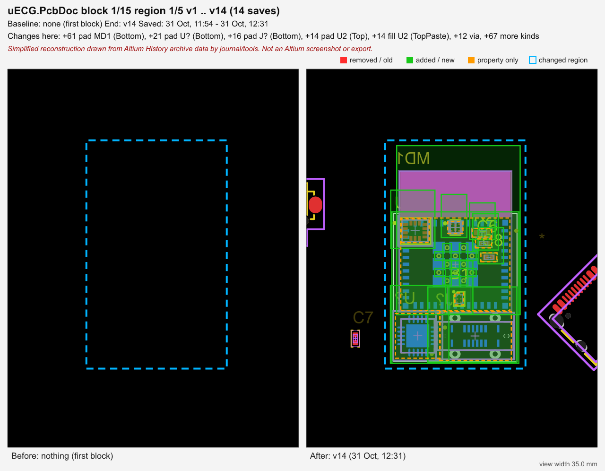

PcbDoc (none) -> v14, `uECG.~(14).PcbDoc.Zip` with no baseline. Other regions: [2](images/pcb-b01-v1-v14-r2.png), [3](images/pcb-b01-v1-v14-r3.png), [4](images/pcb-b01-v1-v14-r4.png), [5](images/pcb-b01-v1-v14-r5.png).

- New board, 13 parts imported. Outline 14.73 x 17.65 mm.

## 3. 31/10 15:33-17:55, about 2 h 22 min

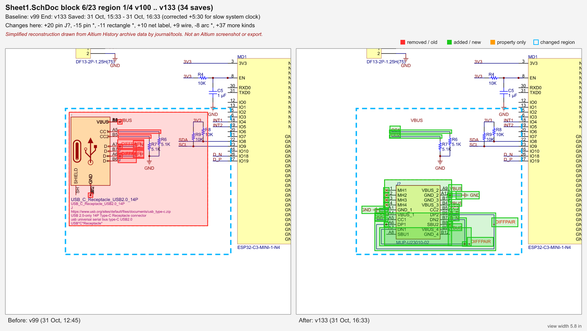

SchDoc v99 -> v133, from `Sheet1.~(99).SchDoc.Zip` to `Sheet1.~(133).SchDoc.Zip`. Other regions: [2](images/sch-b06-v100-v133-r2.png), [3](images/sch-b06-v100-v133-r3.png), [4](images/sch-b06-v100-v133-r4.png).

- MUP-U23010-02 replaced the Molex and USB-C parts. CC, VBUS and D± wired.

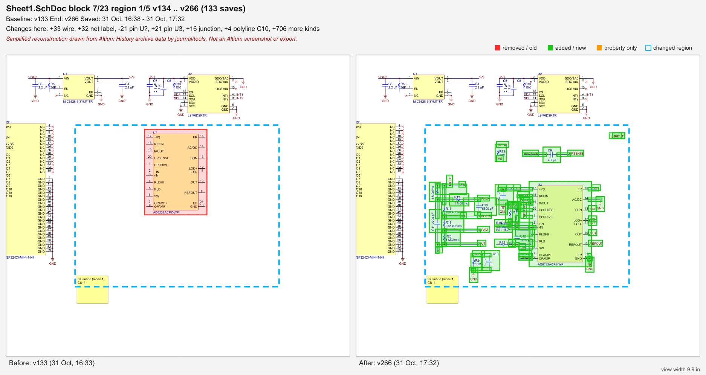

SchDoc v133 -> v266, from `Sheet1.~(133).SchDoc.Zip` to `Sheet1.~(266).SchDoc.Zip`. Other regions: [2](images/sch-b07-v134-v266-r2.png), [3](images/sch-b07-v134-v266-r3.png), [4](images/sch-b07-v134-v266-r4.png), [5](images/sch-b07-v134-v266-r5.png).

- AD8232 support circuit: R12-R24, C9-C14 and its net labels.
- INT2 disconnected. INT1 moved to MD1.19.
- Two errors introduced: IAOUT shorted to SW (fixed in v378) and AD8232 +IN/-IN joined (v209, fixed in v301).

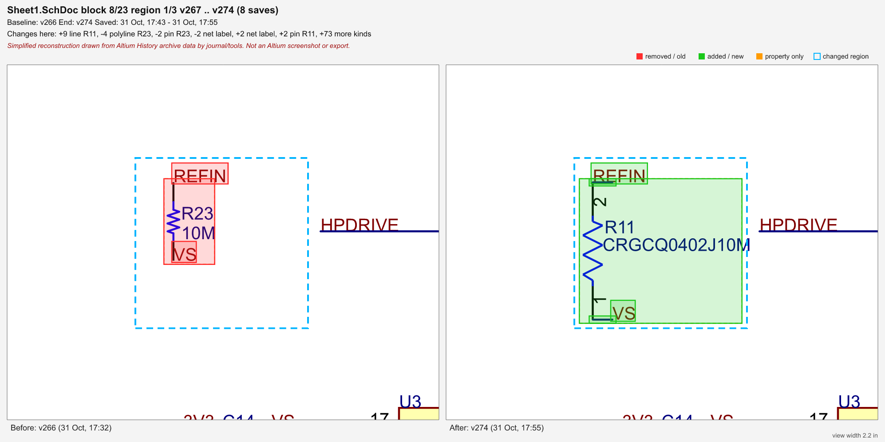

SchDoc v266 -> v274, from `Sheet1.~(266).SchDoc.Zip` to `Sheet1.~(274).SchDoc.Zip`. Other regions: [2](images/sch-b08-v267-v274-r2.png), [3](images/sch-b08-v267-v274-r3.png).

- CRGCQ0402J10M parts for R23 and R11. R8/R9 pull-ups recreated.

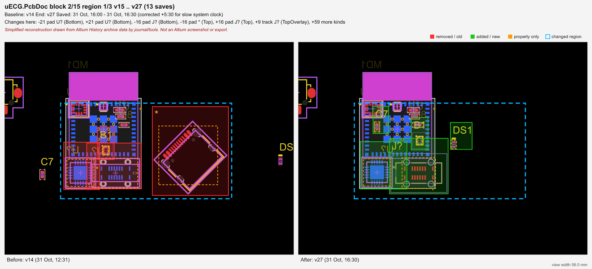

PcbDoc v14 -> v27, from `uECG.~(14).PcbDoc.Zip` to `uECG.~(27).PcbDoc.Zip`. Other regions: [2](images/pcb-b02-v15-v27-r2.png), [3](images/pcb-b02-v15-v27-r3.png).

- USB-C changed to MUPU2301002. Clearance rules tightened.
- 4-layer stack (v24).

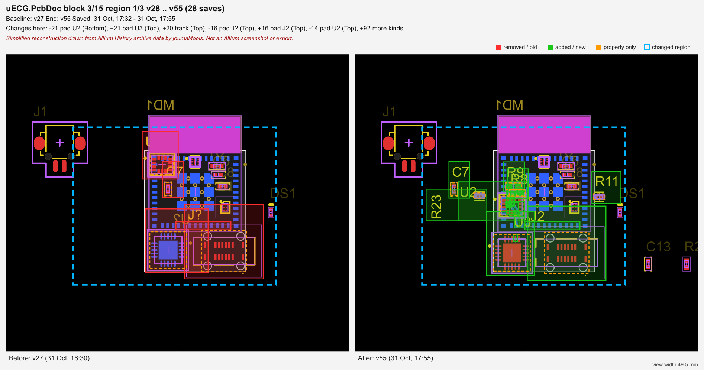

PcbDoc v27 -> v55, from `uECG.~(27).PcbDoc.Zip` to `uECG.~(55).PcbDoc.Zip`. Other regions: [2](images/pcb-b03-v28-v55-r2.png), [3](images/pcb-b03-v28-v55-r3.png).

- 19 AFE passives imported (v29). U3 moved to top. Clearance 3.937 mil (v38).
- SDA/SCL, R8/R9 and 3V3 routed.

## 4. 31/10 19:03, duration unknown

PcbDoc v55 -> v56, from `uECG.~(55).PcbDoc.Zip` to `uECG.~(56).PcbDoc.Zip`. No image, because the files differ but no drawn object changed.

- One save, no drawn change found.

## 5. 31/10 20:32-20:47, about 14 min

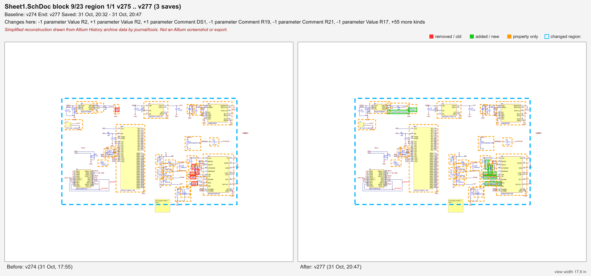

SchDoc v274 -> v277, from `Sheet1.~(274).SchDoc.Zip` to `Sheet1.~(277).SchDoc.Zip`.

- Library re-link. Parameters only.

## 6. 31/10 21:55-22:57, about 62 min

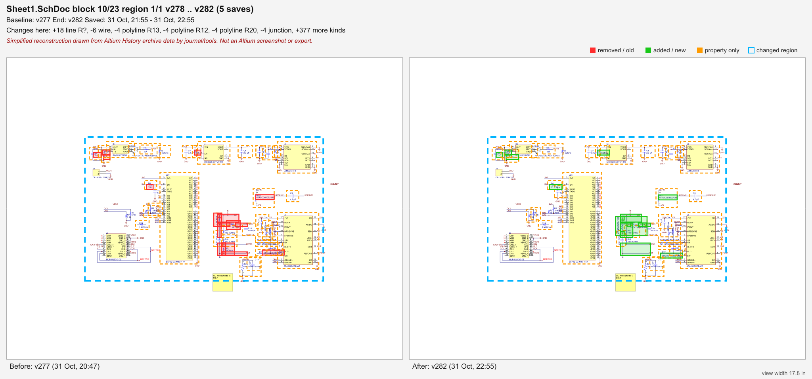

SchDoc v277 -> v282, from `Sheet1.~(277).SchDoc.Zip` to `Sheet1.~(282).SchDoc.Zip`.

- MPN updates for R3-R5, C1-C4.
- Trial: R12, R13 and R20 replaced by two 1 MΩ parts.

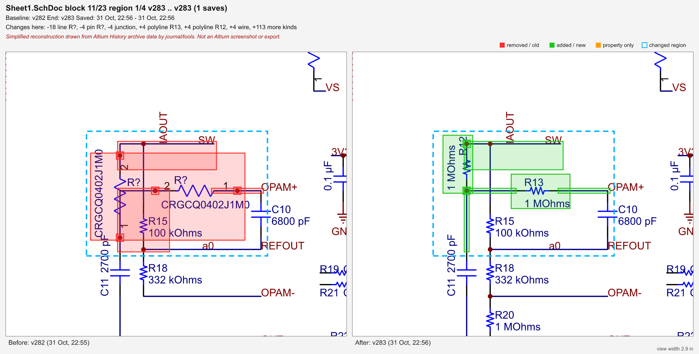

SchDoc v282 -> v283, from `Sheet1.~(282).SchDoc.Zip` to `Sheet1.~(283).SchDoc.Zip`. Other regions: [2](images/sch-b11-v283-v283-r2.png), [3](images/sch-b11-v283-v283-r3.png), [4](images/sch-b11-v283-v283-r4.png).

- Trial reverted. R14 deleted.

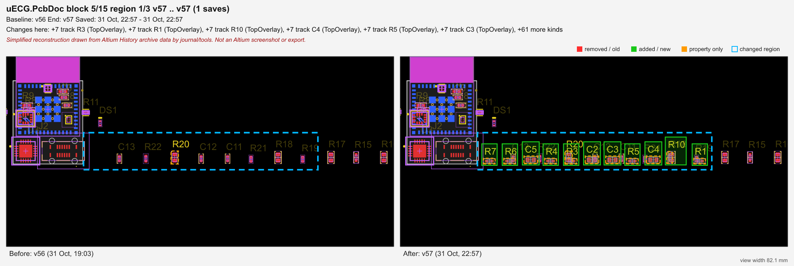

PcbDoc v56 -> v57, from `uECG.~(56).PcbDoc.Zip` to `uECG.~(57).PcbDoc.Zip`. Other regions: [2](images/pcb-b05-v57-v57-r2.png), [3](images/pcb-b05-v57-v57-r3.png).

- 11 passives imported. R14 dropped.

## 7. 01/11 12:13-16:09, about 3 h 55 min

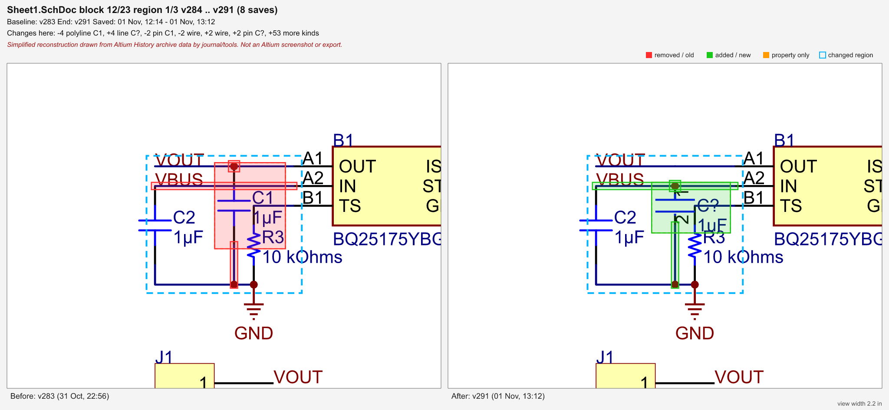

SchDoc v283 -> v291, from `Sheet1.~(283).SchDoc.Zip` to `Sheet1.~(291).SchDoc.Zip`. Other regions: [2](images/sch-b12-v284-v291-r2.png), [3](images/sch-b12-v284-v291-r3.png).

- INT1 and IO2 swapped on MD1. C1 changed to 1 µF 0402 on VBUS.

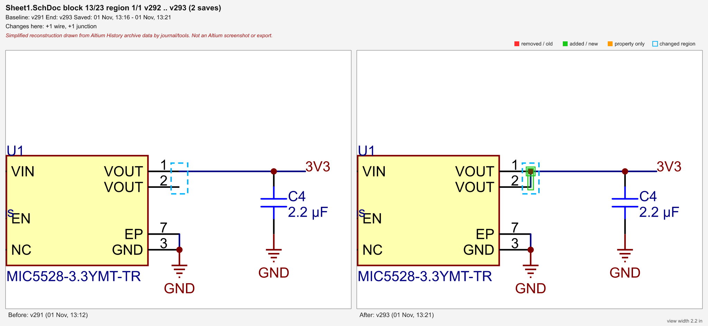

SchDoc v291 -> v293, from `Sheet1.~(291).SchDoc.Zip` to `Sheet1.~(293).SchDoc.Zip`.

- MIC5528 pin 2 joined to 3V3.

SchDoc v293 -> v295, from `Sheet1.~(293).SchDoc.Zip` to `Sheet1.~(295).SchDoc.Zip`. No image, because the files differ but no drawn object changed.

- No drawn change found.

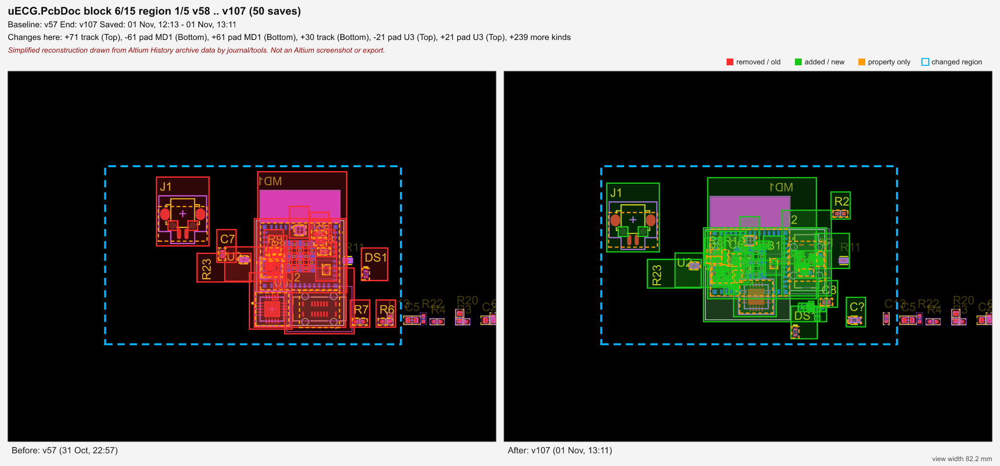

PcbDoc v57 -> v107, from `uECG.~(57).PcbDoc.Zip` to `uECG.~(107).PcbDoc.Zip`. Other regions: [2](images/pcb-b06-v58-v107-r2.png), [3](images/pcb-b06-v58-v107-r3.png), [4](images/pcb-b06-v58-v107-r4.png), [5](images/pcb-b06-v58-v107-r5.png).

- INT1, SDA, SCL, 3V3 and CC routed. MD1 locked.
- Six outline reworks, ending at 20.07 x 15.18 mm.
- VBUS width rule (v104).

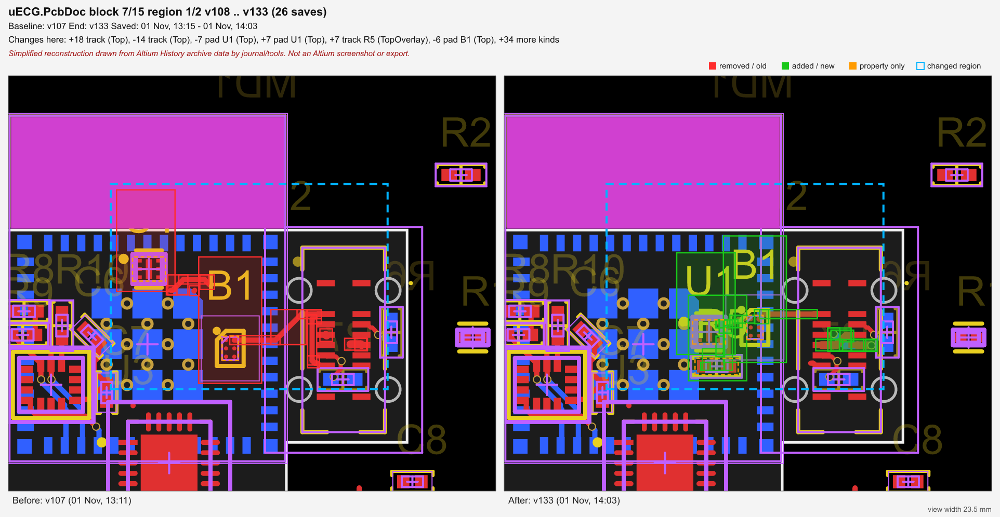

PcbDoc v107 -> v133, from `uECG.~(107).PcbDoc.Zip` to `uECG.~(133).PcbDoc.Zip`. Other regions: [2](images/pcb-b07-v108-v133-r2.png).

- B1 re-placed (v111). U1-2 on 3V3 (v114).
- R5/VOUT and USB D± routed.

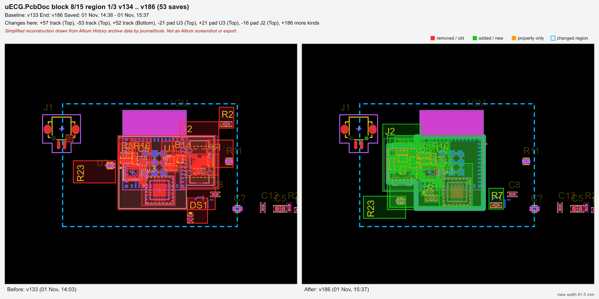

PcbDoc v133 -> v186, from `uECG.~(133).PcbDoc.Zip` to `uECG.~(186).PcbDoc.Zip`. Other regions: [2](images/pcb-b08-v134-v186-r2.png), [3](images/pcb-b08-v134-v186-r3.png).

- Diff-pair rule (v141), D± pair routed (v147-v149).
- J2 moved to the left edge. B1, U1 and R2 moved to bottom.
- Inner layers made GND split planes (v169).

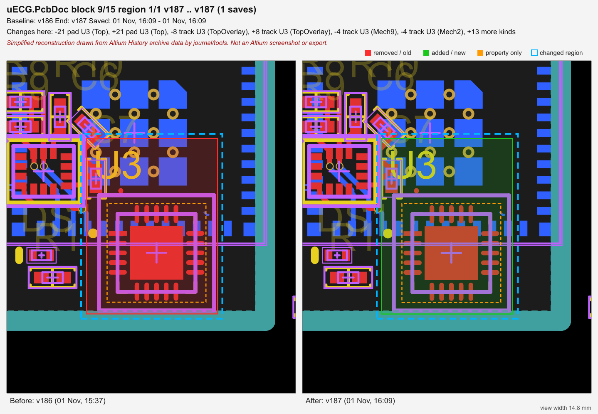

PcbDoc v186 -> v187, from `uECG.~(186).PcbDoc.Zip` to `uECG.~(187).PcbDoc.Zip`.

- U3 nudged 0.04 mm.

## 8. 01/11 19:10-20:12, about 62 min

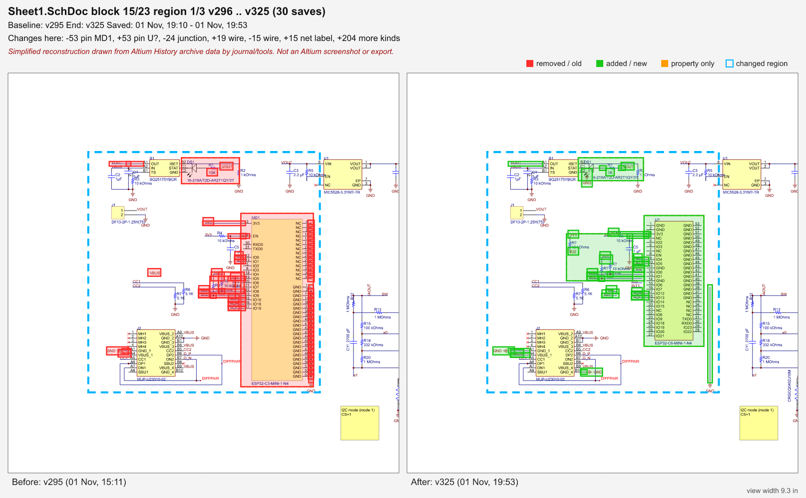

SchDoc v295 -> v325, from `Sheet1.~(295).SchDoc.Zip` to `Sheet1.~(325).SchDoc.Zip`. Other regions: [2](images/sch-b15-v296-v325-r2.png), [3](images/sch-b15-v296-v325-r3.png).

- I2C crossing fixed (v296). AD8232 +IN/-IN separated (v301).
- ESP32-C6-MINI-1-N4 replaced the C3 (v321-v322).
- R8/R9 removed. New 10 kΩ resistors and a 10M (v308). R1 changed to 1K.
- Molex 2-pin added on R19/R21.

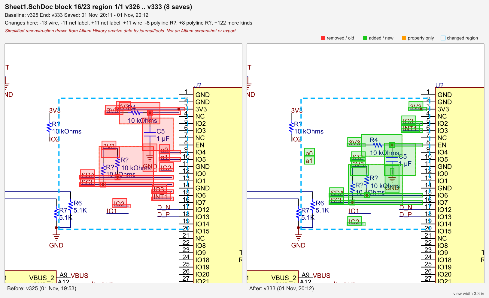

SchDoc v325 -> v333, from `Sheet1.~(325).SchDoc.Zip` to `Sheet1.~(333).SchDoc.Zip`.

- ESP32-C6 pins assigned for INT1, IO3, SDA and SCL.

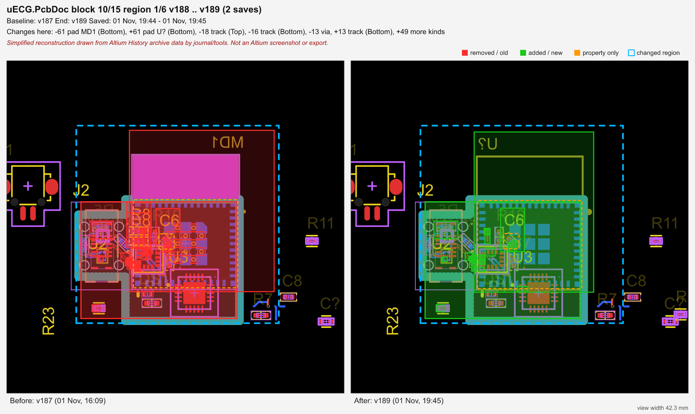

PcbDoc v187 -> v189, from `uECG.~(187).PcbDoc.Zip` to `uECG.~(189).PcbDoc.Zip`. Other regions: [2](images/pcb-b10-v188-v189-r2.png), [3](images/pcb-b10-v188-v189-r3.png), [4](images/pcb-b10-v188-v189-r4.png), [5](images/pcb-b10-v188-v189-r5.png), [6](images/pcb-b10-v188-v189-r6.png).

- ESP32-C6 placed. R8/R9 and 12 GND vias removed. D±, SCL and SDA rerouted.

## 9. 01/11 22:47-02/11 00:06, about 80 min

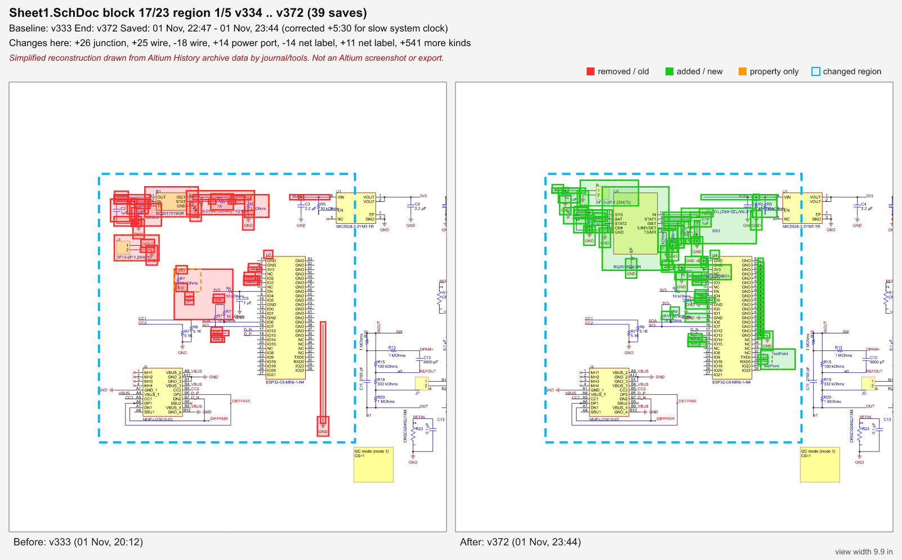

SchDoc v333 -> v372, from `Sheet1.~(333).SchDoc.Zip` to `Sheet1.~(372).SchDoc.Zip`. Other regions: [2](images/sch-b17-v334-v372-r2.png), [3](images/sch-b17-v334-v372-r3.png), [4](images/sch-b17-v334-v372-r4.png), [5](images/sch-b17-v334-v372-r5.png).

- BQ25185DLHR (U5) replaced the BQ25175 (v351). BAT net added.
- Test points on TXD0/RXD0. ESP pins reassigned.

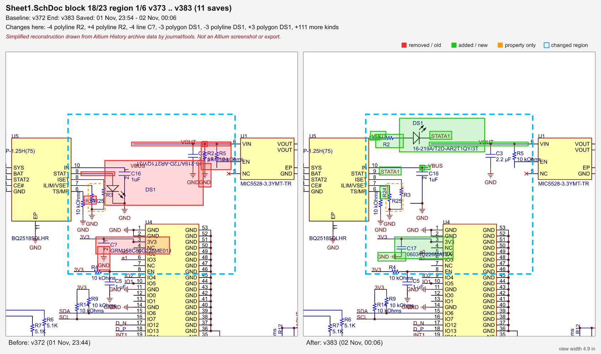

SchDoc v372 -> v383, from `Sheet1.~(372).SchDoc.Zip` to `Sheet1.~(383).SchDoc.Zip`. Other regions: [2](images/sch-b18-v373-v383-r2.png), [3](images/sch-b18-v373-v383-r3.png), [4](images/sch-b18-v373-v383-r4.png), [5](images/sch-b18-v373-v383-r5.png), [6](images/sch-b18-v373-v383-r6.png).

- IAOUT and SW separated (v378).
- R26 100k on IO3. C17 22 µF on 3V3. R25 changed to 18k.
- CE# moved from GND to C2/R1 (v376).

## 10. 02/11 11:12-12:36, about 84 min

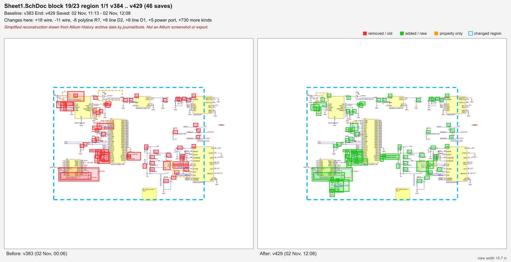

SchDoc v383 -> v429, from `Sheet1.~(383).SchDoc.Zip` to `Sheet1.~(429).SchDoc.Zip`.

- Hirose and 2-pin J3 removed. J1 is a Molex 2-pin on BAT. J3 is a Molex 3-pin to RLD.
- ESD321 diodes D1/D2. C10 22 µF replaced C17.
- Solder jumper joins GND to IO9.
- CE# back on GND (v418). Full re-annotation.

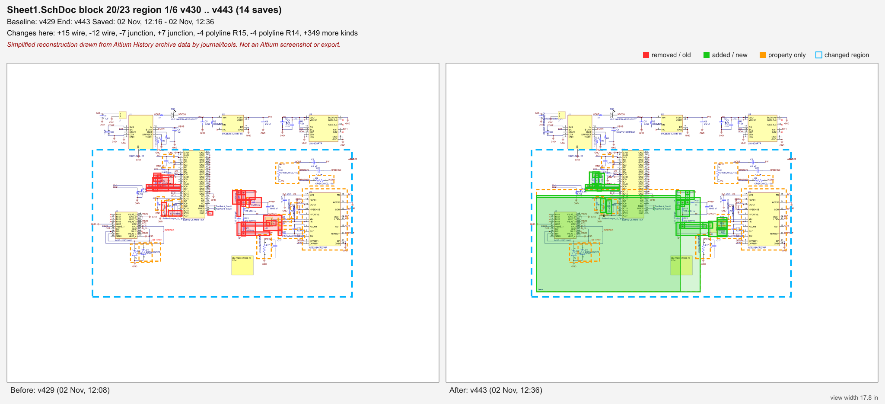

SchDoc v429 -> v443, from `Sheet1.~(429).SchDoc.Zip` to `Sheet1.~(443).SchDoc.Zip`. Other regions: [2](images/sch-b20-v430-v443-r2.png), [3](images/sch-b20-v430-v443-r3.png), [4](images/sch-b20-v430-v443-r4.png), [5](images/sch-b20-v430-v443-r5.png), [6](images/sch-b20-v430-v443-r6.png).

- R14/R15 became 1K. R25 removed. Comments changed to MPNs.

PcbDoc v189 -> v190, from `uECG.~(189).PcbDoc.Zip` to `uECG.~(190).PcbDoc.Zip`. No image, because the files differ but no drawn object changed.

- Silkscreen edit on R1.

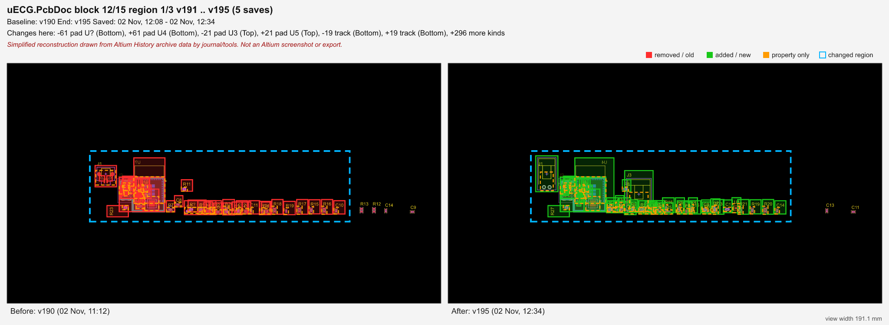

PcbDoc v190 -> v195, from `uECG.~(190).PcbDoc.Zip` to `uECG.~(195).PcbDoc.Zip`. Other regions: [2](images/pcb-b12-v191-v195-r2.png), [3](images/pcb-b12-v191-v195-r3.png).

- Charger and connector rework (v191): U5, J3, D1 and new passives added. B1 and Hirose J1 removed.
- 45 parts re-annotated (v192).

## 11. 02/11 15:39-17:37, about 1 h 57 min

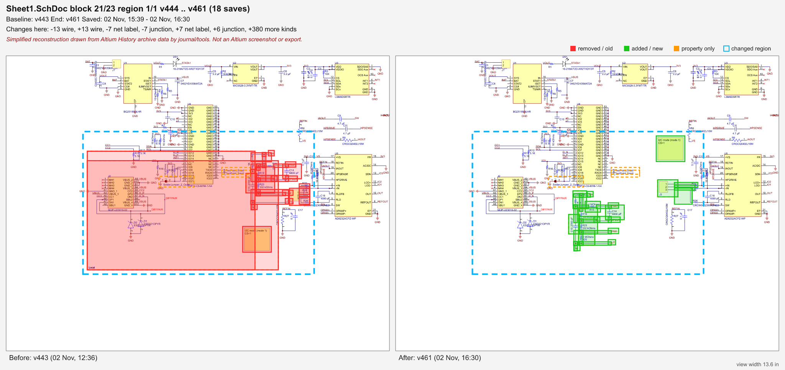

SchDoc v443 -> v461, from `Sheet1.~(443).SchDoc.Zip` to `Sheet1.~(461).SchDoc.Zip`.

- AD8232 output-stage parts re-placed: C14, C15, R14/R15/R25 (1 MΩ), R19 (100k), R23 (332k).

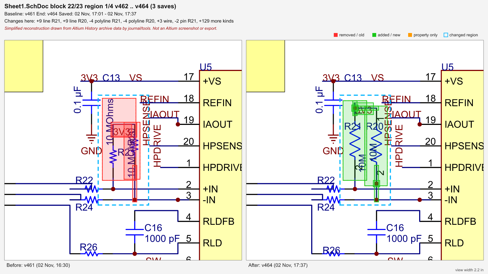

SchDoc v461 -> v464, from `Sheet1.~(461).SchDoc.Zip` to `Sheet1.~(464).SchDoc.Zip`. Other regions: [2](images/sch-b22-v462-v464-r2.png), [3](images/sch-b22-v462-v464-r3.png), [4](images/sch-b22-v462-v464-r4.png).

- R20/R21 changed to CRGCQ0402J10M on 3V3.

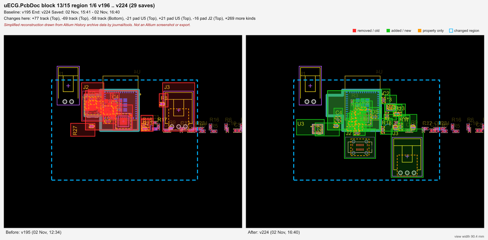

PcbDoc v195 -> v224, from `uECG.~(195).PcbDoc.Zip` to `uECG.~(224).PcbDoc.Zip`. Other regions: [2](images/pcb-b13-v196-v224-r2.png), [3](images/pcb-b13-v196-v224-r3.png), [4](images/pcb-b13-v196-v224-r4.png), [5](images/pcb-b13-v196-v224-r5.png), [6](images/pcb-b13-v196-v224-r6.png).

- Routing ripped up (v202). AFE placement and routing started. U5 locked (v213).

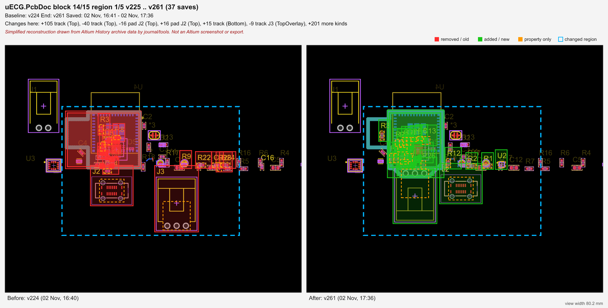

PcbDoc v224 -> v261, from `uECG.~(224).PcbDoc.Zip` to `uECG.~(261).PcbDoc.Zip`. Other regions: [2](images/pcb-b14-v225-v261-r2.png), [3](images/pcb-b14-v225-v261-r3.png), [4](images/pcb-b14-v225-v261-r4.png), [5](images/pcb-b14-v225-v261-r5.png).

- AFE routing continued.
- Board redefined to 14.86 x 17.91 mm (v259). GND planes redrawn.

## 12. 02/11 18:44, duration unknown

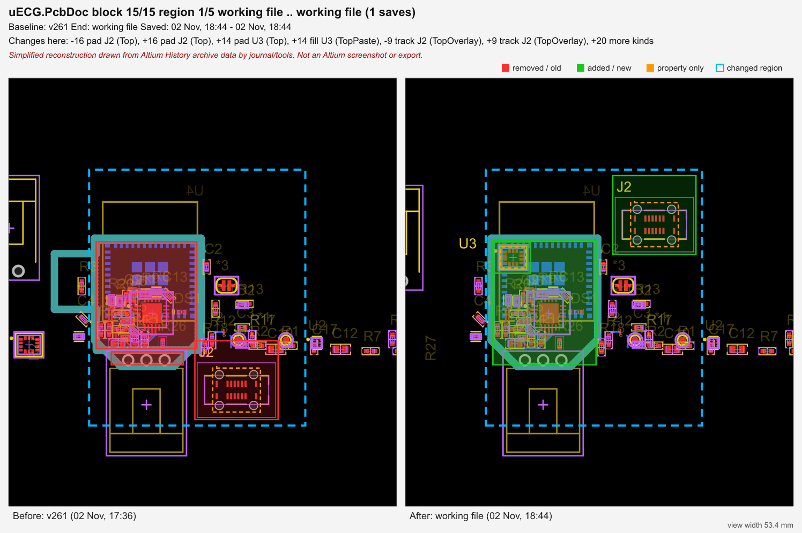

PcbDoc v261 -> working file, from `uECG.~(261).PcbDoc.Zip` to working file `uECG.PcbDoc`. Other regions: [2](images/pcb-b15-wf-wf-r2.png), [3](images/pcb-b15-wf-wf-r3.png), [4](images/pcb-b15-wf-wf-r4.png), [5](images/pcb-b15-wf-wf-r5.png).

- One save. J2 and U3 moved.
- Each inner plane is now one GND polygon.
- Gerbers exported at 18:52.

## 13. 03/11 08:39, duration unknown

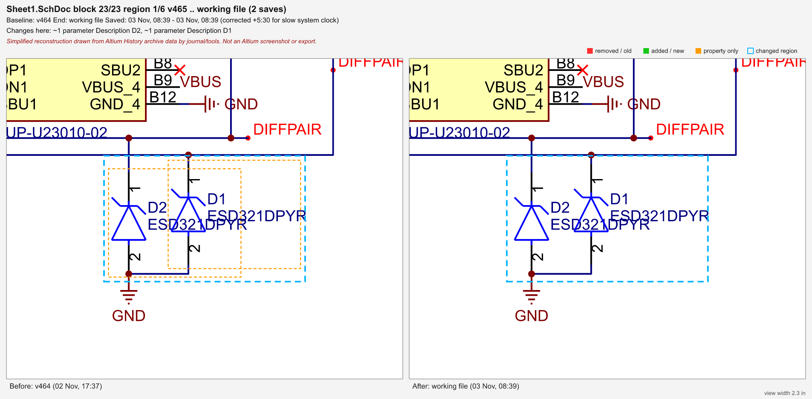

SchDoc v464 -> working file, from `Sheet1.~(464).SchDoc.Zip` to working file `Sheet1.SchDoc`. Other regions: [2](images/sch-b23-v465-wf-r2.png), [3](images/sch-b23-v465-wf-r3.png), [4](images/sch-b23-v465-wf-r4.png), [5](images/sch-b23-v465-wf-r5.png), [6](images/sch-b23-v465-wf-r6.png).

- Two saves 2 s apart. Description parameter removed from 8 parts.
